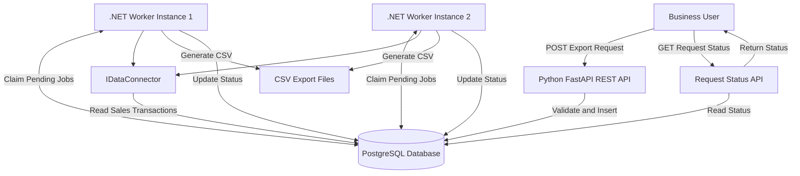

# Sales Data Export System

## 1. Project Overview

The Sales Data Export System is an asynchronous, self-service data export application built with Python FastAPI, C# .NET 8, and PostgreSQL.

The purpose of this system is to allow business users to request sales data exports without depending on the IT team to manually generate reports.

Users submit an export request by specifying a region and date range. The API stores the request in PostgreSQL, and one of the available .NET Worker Service instances processes it in the background.

The worker retrieves matching sales transactions through a reusable database connector, generates a CSV file, and updates the request status.

The system is designed to support concurrent worker instances, efficient data streaming, and recovery from worker failures.

### Technology Stack

| Component             | Technology               |
| --------------------- | ------------------------ |
| REST API              | Python, FastAPI          |
| ORM                   | SQLAlchemy               |
| Background Processing | C# .NET 8 Worker Service |
| Database Connector    | Npgsql                   |
| Database              | PostgreSQL 16            |
| API Validation        | Pydantic                 |
| Export Format         | CSV                      |
| Containerization      | Docker Compose           |
| Version Control       | Git                      |

---

## 2. System Architecture

### High-Level Architecture

The application consists of three main components:

1. **FastAPI REST API:** Accepts export requests, validates input, stores requests, and provides request status information.
2. **PostgreSQL Database:** Stores sales transactions and export requests.
3. **.NET 8 Worker Service:** Processes pending requests asynchronously, retrieves sales data, generates CSV files, and updates request statuses.

### Architecture Diagram



### Request Workflow

1. A business user submits an export request through the FastAPI REST API.
2. FastAPI validates the region and date range.
3. The API inserts the request into PostgreSQL with a `Pending` status.
4. Available .NET Worker instances continuously poll the database for pending requests.
5. A worker safely claims a request using a PostgreSQL transaction and `FOR UPDATE SKIP LOCKED`.
6. The worker retrieves matching sales records through the reusable `IDataConnector` interface.
7. Sales records are streamed asynchronously into a temporary CSV file.
8. After successful export, the temporary file is published as the final CSV file.
9. The worker updates the request status to `Completed`.
10. If processing fails, the worker records the error and updates the status to `Failed`.
11. The user can check the request status through the API.

### Request Status Lifecycle

```text
Pending
   |
   v
Processing
   |
   +------> Completed
   |
   +------> Failed
```

---

## 3. Concurrent Worker Processing

### Multiple Worker Instances

The system supports multiple .NET Worker Service instances running simultaneously.

The assessment specifically requires the system to prevent the same request from being processed by multiple workers at the same time.

For example, two worker instances can run concurrently:

- Worker Instance 1
- Worker Instance 2

Both workers can independently claim and process different pending export requests.

### Duplicate Processing Prevention

The system uses PostgreSQL transactions with:

```sql
SELECT ...
FOR UPDATE SKIP LOCKED
LIMIT 1;
```

The job-claim operation is implemented using a transactional SQL statement that selects and updates the request atomically.

How it works:

1. Worker 1 and Worker 2 attempt to claim pending requests simultaneously.
2. Worker 1 locks the selected request row inside its database transaction.
3. Worker 2 skips rows that are already locked instead of waiting for them.
4. Worker 2 can claim another available pending request.
5. Each worker updates its claimed request to `Processing` before committing the transaction.
6. After the transaction commits, other workers no longer see that request as `Pending`.

This prevents two active workers from claiming the same pending request through the normal job-claiming workflow.

### Worker Ownership

Each worker instance receives a unique worker ID.

The `export_requests` table stores:

- `worker_id`
- `lease_expires_at`
- `started_at`
- `status`

The worker ID is checked when renewing a lease or updating the request status. This prevents a worker that no longer owns a request from updating another worker's job.

### Lease Mechanism and Failure Recovery

A lease mechanism is implemented to recover requests when a worker unexpectedly stops.

- A worker receives a lease of 60 seconds when claiming a request.
- The worker renews its lease every 20 seconds while processing.
- If the worker crashes and the lease expires, another worker can recover the stale request.
- The recovered request is returned to `Pending` so it can be processed again.

This improves reliability and prevents abandoned requests from remaining in `Processing` indefinitely.

### CSV File Safety

The worker writes export results to a temporary file first.

After CSV generation succeeds, the temporary file is moved to its final destination.

The filename is based on the export request ID, which provides a predictable output path when a request needs to be recovered and processed again.

**Reliability note:** The database claim mechanism prevents simultaneous claims of the same pending request. Lease recovery provides retry capability, but a crash between file publication and the database status update can still result in the job being executed again. The implementation therefore does not claim strict end-to-end exactly-once execution.

---

## 4. Database Design

The system uses PostgreSQL 16.

### Main Tables

#### `sales_transactions`

Stores sales transaction records.

| Column             | Description               |
| ------------------ | ------------------------- |
| `id`               | Transaction identifier    |
| `region`           | Sales region              |
| `transaction_date` | Transaction date and time |
| `customer_name`    | Customer name             |
| `amount`           | Transaction amount        |

#### `export_requests`

Stores user export requests and their processing information.

| Column             | Description                                   |
| ------------------ | --------------------------------------------- |
| `id`               | Unique export request ID                      |
| `region`           | Requested sales region                        |
| `start_date`       | Export start date                             |
| `end_date`         | Export end date                               |
| `status`           | Pending, Processing, Completed, or Failed     |
| `file_path`        | Generated CSV file location                   |
| `error_message`    | Error details if processing fails             |
| `created_at`       | Request creation time                         |
| `started_at`       | Processing start time                         |
| `completed_at`     | Processing completion time                    |
| `worker_id`        | ID of the worker currently owning the request |
| `lease_expires_at` | Worker lease expiration time                  |

### Database Scripts

The `database` directory contains:

- `001_schema.sql` — Creates database tables.
- `002_indexes.sql` — Creates database indexes.
- `003_seed.sql` — Inserts at least 100,000 sample sales transactions.

---

## 5. API Endpoints

### Health Check

```http
GET /health
```

Checks whether the API is running.

### Submit Export Request

```http
POST /api/exports
```

Example request:

```json
{
  "region": "Bangkok",
  "start_date": "2025-01-01",
  "end_date": "2025-12-31"
}
```

The API validates the request, creates an export request in PostgreSQL, and returns its unique request ID with a `Pending` status.

### Check Export Request Status

```http
GET /api/exports/{request_id}
```

Returns the current request status and the generated file path when available.

### API Documentation

FastAPI provides interactive API documentation at:

http://127.0.0.1:8000/docs

---

## 6. Database Performance Optimization

### Original Query

```sql
SELECT *
FROM SalesTransactions
WHERE YEAR(TransactionDate) = 2025
  AND CustomerName LIKE '%corp%'
ORDER BY Amount DESC;
```

### Optimized PostgreSQL Query

```sql
SELECT
    id,
    region,
    transaction_date,
    customer_name,
    amount
FROM sales_transactions
WHERE transaction_date >= DATE '2025-01-01'
  AND transaction_date < DATE '2026-01-01'
  AND customer_name ILIKE '%corp%'
ORDER BY amount DESC;
```

### Why Is the Original Query Slow?

1. Applying `YEAR()` to the transaction date column can prevent efficient use of a normal B-tree index on that column.
2. `SELECT *` retrieves every column, including columns that may not be required.
3. A leading wildcard in `LIKE '%corp%'` prevents a normal B-tree index from efficiently supporting the substring search.
4. Sorting the matching records by amount requires additional processing.

### Optimization Approach

**Use a date range instead of applying a function to the date column.**

```sql
transaction_date >= DATE '2025-01-01'
AND transaction_date < DATE '2026-01-01'
```

This makes the date predicate more suitable for a B-tree index.

**Use only the required columns.**

Selecting specific columns reduces unnecessary data retrieval.

**Use PostgreSQL trigram indexing for substring searches.**

```sql
CREATE EXTENSION IF NOT EXISTS pg_trgm;

CREATE INDEX idx_sales_customer_name_trgm
ON sales_transactions
USING GIN (customer_name gin_trgm_ops);
```

The trigram index can improve searches involving patterns such as `%corp%`.

**Inspect the query execution plan.**

```sql
EXPLAIN (ANALYZE, BUFFERS)
SELECT
    id,
    region,
    transaction_date,
    customer_name,
    amount
FROM sales_transactions
WHERE transaction_date >= DATE '2025-01-01'
  AND transaction_date < DATE '2026-01-01'
  AND customer_name ILIKE '%corp%'
ORDER BY amount DESC;
```

The execution plan helps identify whether PostgreSQL uses sequential scans, index scans, bitmap scans, and sorting operations.

### Performance Test

Before adding the trigram index, the optimized PostgreSQL query was tested against the 100,000-row sample dataset.

Observed execution plan:

- Scan method: Sequential Scan
- Rows returned: 16,635
- Rows removed by filter: 83,365
- Sort method: Quicksort
- Execution time: approximately 44.849 ms

The trigram index is an additional optimization to evaluate using `EXPLAIN ANALYZE`. The query planner may still choose a sequential scan depending on data distribution and selectivity.

---

## 7. Design Decisions

### Why FastAPI Instead of Django?

FastAPI was selected because this project primarily requires a REST API rather than a full-stack web application.

Advantages of FastAPI:

- Automatic OpenAPI and Swagger documentation.
- Pydantic request validation.
- Python type hints.
- Asynchronous request handling.
- Lightweight API development.

Django would be a good choice if the project required a larger end-user portal with built-in authentication, admin functionality, and a comprehensive ORM.

### Reusing a .NET Framework 4.6 Library in .NET 8

A .NET Framework 4.6 library cannot generally be referenced directly as a supported dependency from .NET 8.

Possible approaches include:

1. Retargeting or multi-targeting the library to .NET Standard 2.0, provided its APIs are compatible.
2. Extracting reusable business logic into a compatible shared library.
3. Replacing unsupported .NET Framework-specific APIs.
4. Running the legacy library in a separate .NET Framework process and communicating through HTTP, gRPC, or messaging.

.NET Standard 2.0 is supported by .NET 8 and generally requires .NET Framework 4.6.1 or later for the legacy application.

---

## 8. Running the Project Locally

### Prerequisites

- Docker Desktop
- Python 3.12 or compatible Python version
- .NET 8 SDK
- Git

### Start PostgreSQL

From the project root:

```bash
docker compose up -d
```

The Docker Compose configuration initializes the database using the SQL scripts mounted from the `database` directory.

### Start FastAPI

```bash
cd api

python3 -m venv .venv

source .venv/bin/activate

pip install -r ../requirements.txt

uvicorn app.main:app --reload
```

API documentation:

http://127.0.0.1:8000/docs

### Start .NET Worker Service

Open another terminal:

```bash
cd worker/SalesExport.Worker

dotnet restore

dotnet run
```

The worker runs as a console-hosted Worker Service during local macOS development.

The application includes Windows Service hosting configuration and is designed to run as a Windows Service on Windows. Actual Windows Service installation and execution should be tested in a Windows environment.

### Running Multiple Worker Instances

To test concurrent processing, start the worker in two separate terminals.

Terminal 1:

```bash
cd worker/SalesExport.Worker
dotnet run
```

Terminal 2:

```bash
cd worker/SalesExport.Worker
dotnet run
```

Both instances connect to the same PostgreSQL database and independently claim available pending requests.

---

## 9. Testing and Verification

The following functionality has been implemented and tested locally:

- FastAPI health check.
- Export request creation.
- Export request status retrieval.
- PostgreSQL database initialization.
- Seeding 100,000 sales transaction records.
- .NET Worker database connectivity.
- Sales data retrieval through `IDataConnector`.
- Asynchronous CSV generation.
- Export status updates.
- Concurrent processing using two worker instances.
- Worker ownership and lease renewal.
- Stale job recovery.
- SQL query execution plan inspection.

### Example Export Result

A Bangkok export request for 2025 was successfully processed.

Observed CSV output:

- 12,517 sales transaction records.
- 1 CSV header row.
- 12,518 total lines.
- Export request status: `Completed`.

Two worker instances were also run simultaneously, and multiple export requests were successfully completed.

---

## 10. AI Tools Used

ChatGPT was used as an AI-assisted development tool during the assessment for:

- Reviewing system architecture.
- Discussing concurrency and database locking.
- Debugging Python and C# implementation issues.
- Reviewing SQL query optimization.
- Improving documentation and README explanations.

### Example of Correcting AI-Assisted Output

During development, the worker initially treated an expected cancellation of the lease-renewal heartbeat task as a processing failure.

The implementation was reviewed and corrected to handle expected `OperationCanceledException` during graceful heartbeat shutdown.

The corrected implementation was then tested through another export request, which completed successfully.

AI-generated suggestions were reviewed and tested rather than accepted without verification.

---

## 11. Future Improvements

With additional development time, the following improvements would be considered:

### Security

- Add API authentication and authorization.
- Protect generated CSV files from unauthorized access.
- Move database credentials into secure environment variables or a secrets manager.

### Reliability

- Add retry policies with exponential backoff.
- Improve lease-loss cancellation and worker shutdown handling.
- Add request idempotency.
- Add a dead-letter or failed-job retry mechanism.
- Add stronger recovery for crashes during file publication and database updates.

### Performance and Scalability

- Add more worker instances when processing demand increases.
- Benchmark different database indexes against larger datasets.
- Store generated files in object storage such as Amazon S3 or MinIO.
- Add configurable data retention and cleanup policies.

### Testing and Operations

- Add unit and integration tests.
- Add automated concurrency and failure-recovery tests.
- Add structured logging, metrics, and monitoring.
- Add CI/CD pipelines.
- Test actual Windows Service installation and deployment.
- Add a secure CSV download endpoint.

---

## 12. Conclusion

This project demonstrates an asynchronous sales data export workflow using Python FastAPI, C# .NET 8, and PostgreSQL.

It separates API request handling from background data processing, supports multiple concurrent worker instances, and includes database-level job claiming, worker ownership, lease renewal, and stale job recovery.

The design provides a foundation for a scalable self-service export system while allowing further improvements in security, observability, testing, and production deployment.
